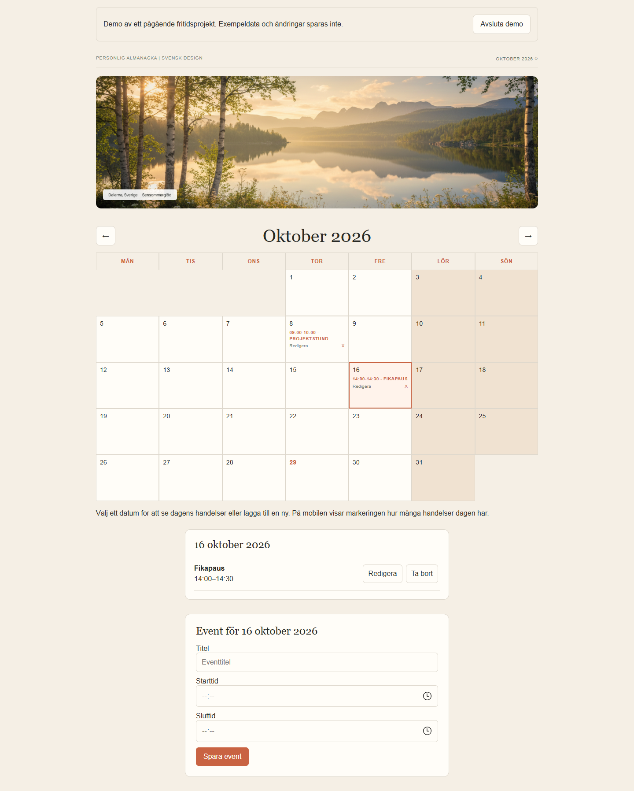
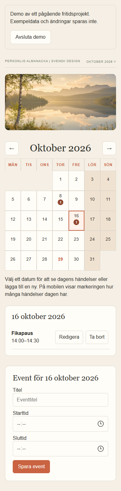

# Calendar

En personlig kalender som jag utvecklar på fritiden för att lära mig mer om användarvänliga gränssnitt och hur frontend, backend och molnlagring hänger ihop. Delar av projektet har också vidareutvecklats inom min utbildning till frontendutvecklare.

**Status: pågående prototyp.** Det här är ett utvecklingsprojekt, inte en färdig produkt.

## Prova demon

Välj **Prova kalendern** på startsidan. Inget konto krävs.

- Byt månad och välj ett datum.
- Skapa, redigera och radera exempelhändelser.
- På mobilen visas antal händelser i datumrutan. Välj datumet för att läsa och hantera händelser i en lista under kalendern.
- Titeln får inte vara tom och sluttiden måste vara senare än starttiden. Händelser över midnatt stöds inte.

**Demon använder påhittade uppgifter.** Ändringar finns bara i minnet under besöket. De skickas inte till något API och återställs när du lämnar demon eller laddar om sidan. Inget sparas i localStorage.

**Publiceringsstatus:** Den nya demon är färdig lokalt men ännu inte publicerad. [Den tidigare S3-versionen](http://calendar-bucket-260921.s3-website.eu-north-1.amazonaws.com) visar fortfarande den äldre inloggningen.

## Bilder

Kalendern på dator med exempeldata:



Mobilvy med valt datum och händelser:



## Vad jag har arbetat med

- Komponentbaserade gränssnitt i React och en sammanhållen visuell form.
- Datumlogik, månadsnavigation och formulär för kalenderhändelser.
- Responsiv layout, formuläretiketter, namngivna knappar och synligt tangentbordsfokus.
- API-integration och hantering av vänteläge och fel i kontoläget.
- Ett separat demoläge som går att prova utan konto eller backend.

## Frontend och separat API

Det här repot innehåller **frontend**, byggd med React, Vite och Zustand. Jag har även byggt ett separat backendprojekt: [Calendar Events API](https://github.com/AngelaRaven84/Calendar-Events-API), med API Gateway, AWS Lambda och DynamoDB.

**Demoläget** använder tillfällig lokal komponentstate. **Kontoläget**, via Logga in med konto, använder det separata API:t och JWT. Backend verifierar tokenen och ägarskapet; jwt-decode i frontend används bara för att läsa användar-ID. Tokenen finns i React-state och sparas inte vid omladdning. Ingen registrering finns i gränssnittet ännu.

## Starta lokalt

Använd Node.js 24:

```bash
npm ci
npm run dev
```

Demon fungerar utan miljöfil och utan backend. För kontoläget krävs ett konto och en `.env.local` med en offentlig API-basadress:

```dotenv
VITE_API_URL=https://DIN-API-BASADRESS
```

API-adressen anges utan `/login` eller `/users`. Starta om Vite efter ändringar. Backendens CORS måste tillåta frontendens origin. Lägg aldrig JWT-hemligheter eller AWS-nycklar i frontend.

```bash
npm run lint
npm run build
```

## Kända begränsningar och fortsättning

- Demodata återställs och är inte permanent lagring.
- Månadsspecifika anteckningar och Månadens fokus är idéer för fortsatt utveckling.
- Kontoläget saknar registreringsvy och automatisk hantering av utgången session. Utloggning rensar den lokala sessionen.
- Den äldre skolpubliceringen använder HTTP. HTTPS och en uppdaterad publicering återstår.
- Tillgänglighetsarbetet pågår; projektet har inte genomgått en fullständig tillgänglighetsrevision.

## Verifiering

Demons grundflöde har testats lokalt med skapa, redigera, radera, avbruten radering, månadsbyte och återställning. Nätverkskontroll visade inga API-anrop från demon. Sara har också provat grunddemon manuellt. Den uppdaterade dagslistan har testats på mobil, inklusive titel- och tidsvalidering. Vyer på dator och mobil har granskats visuellt; ingen horisontell överbredd uppmättes vid 320 och 390 pixlar. Lint och produktionsbygge passerar.

Kontolägets AWS-flöde verifierades manuellt av Sara i september 2026. Det har inte testats på nytt inom arbetet med demon. [Tidigare arbetslogg och publiceringsinstruktioner](docs/DEVELOPMENT_HISTORY.md).
